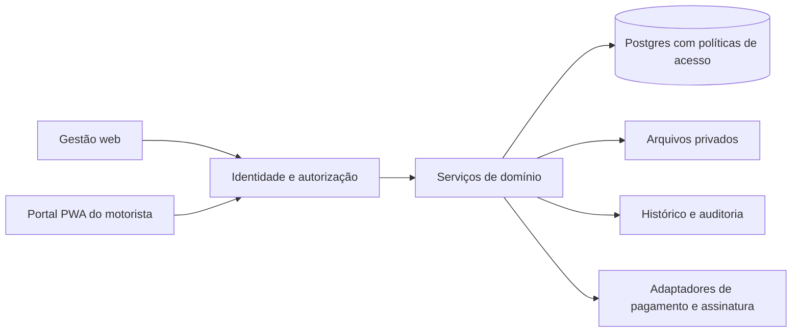

# Arquitetura proposta · v2

**Estado:** desenho para implementação futura. A entrega atual é HTML/CSS/JavaScript local, sem backend e sem instalação de dependências. Não existem tabelas criadas ou integrações conectadas neste novo repositório.

## 1. Escolha inicial

Proposta: React + TypeScript + Vite para gestão e portal PWA, organizados por domínio; Supabase/Postgres para dados, Auth para identidade e Storage privado para anexos. Operações críticas de dinheiro, estoque, contrato e integração executadas transacionalmente no servidor/banco. Reaproveita conhecimento da stack do legado sem copiar sua complexidade de produto.

Aplicação modular única e um banco separado do legado. Não há justificativa inicial para microsserviços, data lake, barramento próprio, plataforma de agentes ou aplicação nativa paralela. A escolha de fornecedor será revisada antes de implementação; versões serão fixadas e lockfile versionado.

## 2. Modelo de domínio conceitual

| Grupo | Entidades e relações propostas |
|---|---|
| Acesso | Empresa, usuário, vínculo/perfil; motorista ligado à identidade autenticada |
| Ativos | Veículo, aquisição, financiamento, parcela de dívida, leitura de km, documento, apólice |
| Locação | Motorista, contrato, condições versionadas, período de vínculo, aditivo, signatário, documento/evidência |
| Operação | Vistoria, item/foto, ocorrência, plano preventivo, serviço, fornecedor, custo e indisponibilidade |
| Financeiro | Conta, categoria, título a pagar/receber, parcela, recebimento/pagamento, alocação parcial, estorno, transferência, caução, reserva, aporte/retirada |
| Loja | Produto, lote/validade, compra, localização, kit/custódia, transferência, movimento, venda/item, pagamento da venda, regra de comissão, acerto/repasse |
| Planejamento | Cenário, versão, premissa/fonte/data, resultado e vínculo opcional com aquisição realizada |
| Evidências | Arquivo, evento de auditoria, notificação e evento externo recebido |

Dinheiro: inteiro em centavos ou decimal exato com escala definida, moeda BRL. Quantidades: unidade inteira ou decimal conforme SKU. Identificadores estáveis; chaves estrangeiras com integridade de empresa e índices úteis ao acesso. Saldo deriva de movimentos ou de projeção transacional conciliável, sem campo editável solto. Snapshot de preço, custo e comissão em cada venda preserva o passado.

Uma única empresa na interface inicial; identificador de empresa prepara isolamento e consistência, sem acrescentar configuração multiempresa comercial. Cadastros referenciados são inativados em vez de apagar histórico financeiro/contratual.

## 3. Consistência transacional

- **Contrato:** criação/ativação verifica período e disponibilidade; restrição no banco impede sobreposição do mesmo veículo. A troca de motorista encerra um vínculo e abre outro de forma auditável.
- **Cobrança:** chave única por contrato/período/tipo. Recebimento e sua alocação são diferentes da cobrança. Saldo = título − alocações válidas, considerando estornos. Arredondamentos e ajustes têm registro.
- **Manutenção:** finalizar serviço e criar sua despesa são uma operação idempotente. Alterar serviço depois exige ajuste, sem duplicação silenciosa.
- **Transferência de estoque:** identifica origem/destino e etapa em trânsito; confirmação movimenta custódia com as contrapartidas na mesma transação. Evitar registrar entrada sem saída correspondente.
- **Venda:** valida custódia e lote, bloqueia saldo necessário e registra item/custo/preço, baixa, comissão e recebível/recebimento atomicamente. Não confiar no saldo enviado pelo navegador.
- **Acerto:** reúne período, dinheiro recebido por cada parte, valores de repasse e comissão, sem compensar aluguel automaticamente. Fechamento preserva snapshot; reabertura gera ajuste controlado.
- **Integração:** autenticar webhook, guardar identificador externo único, processar uma vez, permitir reprocessamento e registrar estado de erro. Nunca baixar cobrança somente porque o frontend mostrou sucesso.

## 4. Acesso e arquivos

As políticas devem combinar perfil, empresa e relacionamento real. Motorista não ganha acesso à frota inteira apenas por pertencer à mesma empresa. O vínculo autenticado define os identificadores sensíveis; o cliente não escolhe livremente `empresa_id`, motorista, custo ou papel. Autorização não usa metadata editável pelo próprio usuário.

RLS nas tabelas expostas, privilégios mínimos por operação, políticas de leitura e de escrita coerentes e testes de allow/deny com dois motoristas. Views expostas respeitam o acesso do chamador. Credenciais privilegiadas ficam exclusivamente no servidor. Diretrizes verificadas na [documentação de RLS do Supabase](https://supabase.com/docs/guides/database/postgres/row-level-security).

CNH, contratos, fotos e evidências em buckets privados, com caminhos vinculados ao domínio e política de acesso por registro. URLs de acesso temporário quando necessário; não tornar o bucket público para resolver erro de autorização. Ver [controle de acesso do Storage](https://supabase.com/docs/guides/storage/security/access-control).

Retenção, consentimentos, acesso após encerramento e política de privacidade serão definidos conforme documentos e atividade com assessoria apropriada. Os ganhos e despesas da jornada pessoal do motorista exigem um domínio privado, separado das receitas da locadora. A localização contínua não é requisito para a locação semanal.

## 5. Experiência e conexão móvel

Leitura e escrita mostram carregamento, sucesso, falha e possibilidade de repetir sem duplicar. Formulário só anuncia “salvo” após confirmação. PWA inicial permite instalação e interface adaptada; isso não promete funcionamento offline completo, push universal nem GPS de fundo. No primeiro piloto, dados pessoais e fotos não ficam persistidos offline sem projeto específico.

Financeiro e simulador compartilham definições de métricas, mas mantêm bases separadas: cenário hipotético não contamina registros reais. Uma premissa pode ser comparada ao realizado; editar o cenário não reescreve o passado.

## 6. Entrega e ambiente

Desenvolvimento, homologação e produção separados; migrations revisadas e testadas localmente; sem aplicar SQL remoto como parte do setup do frontend. Backups com restauração ensaiada, logs sem documentos ou credenciais, trilha de auditoria para mudanças financeiras, exportação do proprietário e monitoramento de falhas.

CI executa verificações do código e testes de domínio/permissão conforme surgirem. Deploy e contas dos fornecedores só entram quando o ambiente e o escopo estiverem definidos. Não conectar este planejamento ao projeto Supabase antigo por conveniência.

## 7. Plano, observado e revisão

O domínio de planejamento passa a guardar versões do plano e suas premissas/fontes/resultados. A versão publicada é independente do rascunho. O domínio financeiro e as aquisições alimentam fechamentos observados, com fontes, confirmações e conciliação. A comparação alinha as definições e períodos. A revisão prospectiva parte de um snapshot validado, preservando tanto o histórico quanto o plano anterior.

O protótipo usa `src/growth.js` para a projeção e `src/control.js` para registros demonstrativos. O estado local não representa um mecanismo seguro de autorização ou auditoria imutável. Na aplicação real, versão, evento, fechamento e permissão são impostos pelo servidor/banco; os dados da jornada pessoal não passam a ser acessíveis à empresa apenas por compartilharem o mesmo usuário ou contrato.
