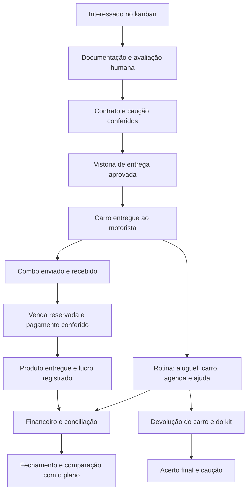

# Auditoria dos fluxos da RODAVOLT

18/10/2026 · nova plataforma RODAVOLT, branch `dev` · planejamento e protótipo local.

A plataforma já permite avaliar as principais rotinas do proprietário e do motorista. A auditoria encontrou e corrigiu falhas de datas, saldos, vínculos e estoque. A operação real ainda precisa de cobrança recorrente por contrato, encerramento completo, persistência com acesso individual e integrações homologadas. Aprovação dos testes locais não significa autorização para usar dinheiro, documentos ou motoristas reais nesta versão.

## Percurso da operação

A geração recorrente dos aluguéis após E e a condução integrada de L/M são pendências. Hoje existem os componentes de vistoria, contas, crédito, estoque e caução, mas a mudança de etapa no kanban não executa esse ciclo completo.

## Cobertura por área

| Área | O que foi conferido | Situação e limite |
|---|---|---|
| Entrada do motorista | Documentação, avaliação manual, contrato vigente do carro, caução por data, vistoria do ciclo e disponibilidade | Gates locais testados; login/documentos reais pendentes |
| Contratos | Modelos e versões, revisão, fila, assinatura de ambas as partes, recusa/cancelamento, leitura por perfil | Simulação; rótulos de cancelado/recusado/vencido corrigidos |
| Entrega do carro | Bloqueio de carro ocupado, vistoria aprovada e novo ciclo | Falta gerar a agenda de cobranças a partir do contrato |
| Vistoria | Quatro passos, itens de segurança, fotos de exemplo, correção e aprovação | Vínculo encerrado não cria nova vistoria; aprovação histórica não altera carro atual; fotos continuam temporárias |
| Rotina do motorista | Metas/custos, análise manual de corrida, ganho por km/hora, registro do dia, pedidos e respostas | Sem captura automática de Uber/99; sem homologação com motoristas reais |
| Manutenção | Solicitação, resposta, OS, indisponibilidade e custo lançado uma vez | Cuidados do carro atual entram na agenda do motorista; definir recorrência/intervalos e prazos de serviço |
| Agenda | Eventos manuais e derivados, conclusão na origem, filtro por vínculo | Consumidor de lembretes locais incluído; depende do app aberto e do relógio do dispositivo; push externo pendente |
| Painel ativo | Contexto carro/motorista, idade da amostra, perda de sinal, histórico e aluguel após crédito | Posições fictícias; nenhum rastreador conectado |
| Financeiro | Pagar/receber, baixa, caução, crédito, caixa/resultado/patrimônio e referência dos lançamentos | Datas de caução corrigidas; estorno operacional completo e fechamento homologado pendentes |
| Conciliação | Correspondência por conta/sentido/centavos, uma evidência por movimento, desfazer e baixa pela origem | Extrato demonstrativo/manual; banco não escolhido |
| Lojinha | Combo multproduto, trânsito, recebimento/divergência, estoque por motorista, reserva/cancelamento, pagamento e entrega | Fluxo local implementado; Pix real, expiração e devolução de venda paga pendentes |
| Estratégia | Premissas, financiamento, fluxo completo, cenários, plano preservado e reestimativa pelo fechamento | Calendários incompatíveis bloqueados; meses sem registros preservam evolução contábil sem inventar realizado |
| Benefícios | Ganho da loja, saldo/crédito e indicação de benefícios previstos | Acesso ao app de finanças pessoais e parcerias ainda não ativados |
| Multas e sinistros | Campos/condições em minutas e despesas manuais | Falta uma jornada própria de notificação, prazo, responsável, contestação/seguro e acerto por vínculo |
| Encerramento | Manutenção das dívidas, créditos e caução no livro | Falta condução integrada de devolução física, kit, acerto e liberação do carro |

## Falhas encontradas e correções

| ID | Prioridade | Falha reproduzida | Correção e evidência |
|---|---|---|---|
| A01 | P1 | Recebimento de caução em fevereiro liberava entrega em janeiro e permitia devolução anterior ao recebimento | Saldo por competência; devolução valida toda a cronologia, inclusive valores já comprometidos em devoluções posteriores. `src/control.js`, `program.js`, `finance.js`; regressões em `tests/audit-finance-flows.test.mjs` |
| A02 | P2 | Mês sem lançamentos pulava depreciação no lucro acumulado, mas depreciava o ativo | Evolução mensal contínua; `hasRecords:false` mantém a ausência de realizado na comparação. Mesmo patrimônio e lucro acumulado com ou sem lançamento zero. `src/control.js` e testes financeiros |
| A03 | P2 | Trocar ano/mês inicial permitia comparar novembro com janeiro pelo mesmo ordinal e reestimar a partir do mês errado | Snapshot inclui calendário; comparação, nova referência e revisão exigem compatibilidade. Rascunhos continuam livres para simular outros calendários sem substituir o livro |
| A04 | P2 | Painel ativo mostrava R$1.050 após desconto de R$57, enquanto carteira mostrava R$993 | Painel usa o mesmo saldo do motor de crédito. Smoke de render e percurso no navegador confirmaram R$993 |
| A05 | P2 | Contrato cancelado com registro de assinatura aparecia como aguardando a locadora | Estados cancelado/recusado/vencido têm prioridade no rótulo do app |
| A06 | P2 | Manutenção e revisão ligadas apenas ao carro ficavam fora da agenda do motorista | `driverAgendaItems` inclui cuidados do carro atual e não expõe documentos/cobranças de outros perfis. Sete regressões de operação cobrem vínculo/agenda/vistoria |
| A07 | P1 | Ex-motorista podia criar rotina no carro antigo já atribuído a outra pessoa; parecer antigo podia alterar a liberação atual | Nova vistoria exige estágio/vínculo/carros corretos; parecer histórico preserva o registro sem alterar km ou liberação do novo ciclo |
| A08 | P2 | Horário de lembrete existia no cadastro, sem consumidor na interface | Verificação local a cada 30 segundos com o app visível, filtro por perfil e aviso uma vez por compromisso/horário na sessão. Reabertura e notificações de celular não são garantias deste mecanismo |
| A09 | P1 | Kit global, venda sem titular e baixa por declaração não representavam entrega de combo nem espera do Pix | Novo motor `src/shop.js`: custódia individual, reserva, confirmação da gestão em cópia transacional, acerto só das vendas do pedido e entrega idempotente. 28 testes específicos |
| A10 | P1 | Reposição podia ser associada a combo de outro motorista; envio parcial podia parecer pedido atendido | Vínculo no motor com validação de titular/produto/estado antes de mutação; saldo recebido e faltante calculado por todos os combos ligados. Cancelar/repetir não duplica contagem. Seis testes novos |

P1: pode comprometer entrega, dinheiro ou estoque. P2: informação incorreta ou quebra de continuidade da rotina. Todas as correções acima permanecem limitadas ao demonstrador local.

## Pendências para o primeiro carro

### 1. Cobrança semanal por contrato

Ativar outro motorista ainda não cria suas cobranças: os quatro aluguéis iniciais são a abertura fictícia de Marcos. Não há rotina de emissão semanal. Antes do piloto, definir pagamento antecipado ou posterior, dia de vencimento, primeira semana parcial, encerramento parcial, reajuste e atraso. Implementar uma agenda idempotente por vínculo/competência, preservando o preço do contrato. Critério: duas semanas, dois motoristas e reenvio sem cobrança duplicada; o app e a gestão veem o mesmo saldo.

### 2. Devolução e encerramento

Hoje o kanban pode encerrar e soltar o carro sem conduzir a vistoria de retorno e a contagem do kit. Dívidas permanecem no livro, mas isso não prova que o carro voltou fisicamente. Criar uma jornada com devolução agendada, vistoria/km/combustível, estoque retornado/avariado, acerto final e caução. Disponibilidade física e pendência financeira precisam ser tratadas separadamente: dívida não desaparece e não se deve inventar retenção automática de caução. Critério: carro só volta a disponível depois da conferência física; cada saldo final mantém sua origem.

### 3. Exceções da lojinha

Combo parcial e cancelamento antes do recebimento já têm caminho. Pedido sem pagamento pode ser cancelado, liberando reserva. Venda paga não pode ser apagada: ainda falta a jornada de devolução/reembolso, retorno físico e reversão correspondente do crédito/CMV/recebimento. Faltam expiração de cobrança, tratamento de pagamento tardio, referência bancária real, catálogo com fotos/lote/validade/garantia e regras de taxas/perdas. Não descontar perdas do motorista automaticamente.

### 4. Base operacional e integrações

Autenticação e permissões por motorista, banco transacional, arquivos privados, auditoria e recuperação são bloqueios de produção. A troca de perfil atual é apenas demonstração. Homologar dois acessos concorrentes, transação interrompida, evento repetido, rede indisponível e restauração do backup. Definir também o fuso dos compromissos da operação: o aviso local atual segue o relógio do dispositivo, que pode estar em outro fuso. Depois integrar banco/Pix, assinatura, rastreador e notificações com fornecedores escolhidos. Nenhuma credencial, migration remota ou publicação de produção faz parte desta entrega.

### 5. Semana real de homologação

Usar valores/condições aprovados para o carro efetivo e revisar minutas com profissional. Percorrer do interessado ao encerramento; conferir extrato, livro, inventário e obrigações diariamente. Medir se o motorista entende os botões e consegue receber combo, vender, fazer vistoria e pedir ajuda. A auditoria técnica não substitui esse teste com a pessoa que vai dirigir.

## Validação realizada

- `npm run check`: 223 testes aprovados, build e sintaxe do controlador completo; número final registrado também em `docs/VALIDACAO.md`.
- 28 testes da lojinha, seis de acerto por pedido, dez de datas/contabilidade/calendário e sete de operação adicionados nesta etapa, além dos 172 anteriores.
- Navegador em `?qa=1`: envio de 2 unidades de cada SKU não alterou o disponível; recebimento mudou 4/5/6 para 6/7/8; pedido de um perfume reservou uma unidade; pagamento fictício gerou crédito de R$57 e saldo 5/7/8; entrega não baixou outra unidade.
- Aplicar os R$57 no aluguel de R$1.050 mostrou R$993 no app e no painel ativo da gestão; o crédito disponível passou a zero. Sessão de teste isolada, sem gravar esses movimentos na sessão principal.
- Caminhos de divergência/cancelamento, isolamento de estoque, preço preservado, reenvio e rollback de erro estão cobertos nos testes do motor. Integrações e concorrência entre dispositivos não foram homologadas.
- Leitura das telas e testes dos demais módulos; este registro não afirma que cada combinação de telas passou por uma sessão manual de navegador nesta rodada.

## Fluxo de compra recomendado

Motorista escolhe produto e quantidade → apresenta Pix daquela venda → cliente paga pelo app do banco → confirmação chega → motorista entrega → estoque e lucro ficam registrados. Não exigir site, cadastro de passageiro, endereço ou instalação de outro app no caminho principal.

QR fixo no carro pode abrir um catálogo em uma etapa posterior. Ele seria um link para escolher produtos; a cobrança Pix seria criada para o pedido específico. No piloto sem integração, uma pessoa autorizada confere o crédito no extrato e vincula ao pedido. Comprovante ou botão “já paguei” não equivalem a confirmação.

A proposta é consistente com a cobrança imediata e identificação por pedido da [API Pix oficial do Banco Central](https://github.com/bacen/pix-api/blob/master/openapi.yaml), o [manual de iniciação do Pix](https://aprendervalor.bcb.gov.br/content/estabilidadefinanceira/pix/Regulamento_Pix/II_ManualdePadroesparaIniciacaodoPix.pdf) e o exemplo técnico de [webhook autenticado da Efí](https://dev.efipay.com.br/docs/api-pix/webhooks/). Isso não escolhe um fornecedor. O protótipo exibe uma área reservada para o QR, sem chave ou cobrança pagável.
