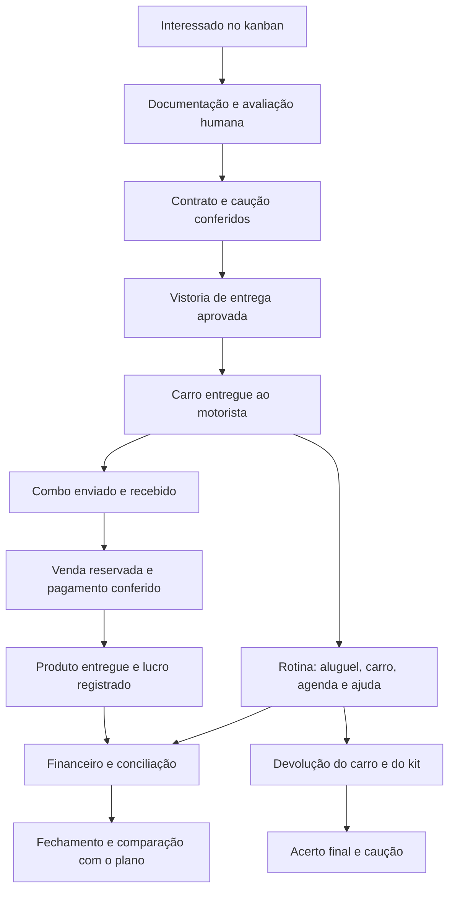

# Auditoria dos fluxos da RODAVOLT

18/10/2026 · nova plataforma RODAVOLT, branch `dev` · v5, implementação e homologação local.

A rodada inicial encontrou e corrigiu falhas de datas, saldos, vínculos e estoque. Após autorização para implementar, a v5 acrescentou cobrança por contrato, devolução guiada, exceções da loja, ocorrências e base persistente com acessos individuais para homologação local. Este relatório preserva os achados históricos e registra seu novo fechamento. Integrações reais, condições do primeiro carro, revisão profissional e piloto com motorista continuam pendentes; testes locais não declaram produção pronta.

## Percurso da operação

Na v5, E ativa uma agenda contratual previamente conferida. L/M agora têm jornada de agendamento, vistoria de retorno, carro/chaves, kit e demonstrativo; o kanban não contorna a conferência física. Valores ainda são de exemplo e dinheiro não é transferido por esta aplicação.

## Cobertura por área

| Área | O que foi conferido | Situação e limite |
|---|---|---|
| Entrada do motorista | Documentação, avaliação manual, contrato vigente do carro, caução por data, vistoria do ciclo e disponibilidade | Gates locais e acesso individual no serviço; documentação real e uso do primeiro carro não homologados |
| Contratos | Modelos e versões, revisão, fila, assinatura de ambas as partes, recusa/cancelamento, leitura por perfil | Simulação; rótulos de cancelado/recusado/vencido corrigidos |
| Entrega do carro | Bloqueio de carro ocupado, vistoria aprovada e novo ciclo | Agenda da versão/carro/ciclo confere o início e acompanha a entrega; cobrança vencida confirmada pelo proprietário |
| Vistoria | Quatro passos, itens de segurança, fotos de exemplo, correção e aprovação | Vínculo encerrado não cria nova vistoria; aprovação histórica não altera carro atual; fotos temporárias na prévia; privadas e filtradas no serviço local |
| Rotina do motorista | Metas/custos, análise manual de corrida, ganho por km/hora, registro do dia, pedidos e respostas | Sem captura automática de Uber/99; sem homologação com motoristas reais |
| Manutenção | Solicitação, resposta, OS, indisponibilidade e custo lançado uma vez | Planos explícitos por km/data, prazo da oficina, agenda por vínculo e conclusão idempotente; estimativa não vira despesa |
| Agenda | Eventos manuais e derivados, conclusão na origem, filtro por vínculo | Consumidor de lembretes locais incluído; depende do app aberto; serviço identifica fuso demonstrativo America/Sao_Paulo; push externo pendente |
| Painel ativo | Contexto carro/motorista, idade da amostra, perda de sinal, histórico e aluguel após crédito | Posições fictícias; nenhum rastreador conectado |
| Financeiro | Pagar/receber, baixa, caução, crédito, caixa/resultado/patrimônio e referência dos lançamentos | Datas corrigidas; estorno com origem, recebimentos acumulados, repasse e devolução locais; fechamento fiscal e banco real pendentes |
| Conciliação | Correspondência por conta/sentido/centavos, uma evidência por movimento, desfazer e baixa pela origem | Extrato demonstrativo/manual; banco não escolhido |
| Lojinha | Combo multproduto, trânsito, recebimento/divergência, estoque por motorista, reserva/cancelamento, pagamento e entrega | Expiração, tardio, devolução/reembolso e quarentena implementados localmente; Pix real e múltiplos lotes por SKU pendentes |
| Estratégia | Premissas, financiamento, fluxo completo, cenários, plano preservado e reestimativa pelo fechamento | Calendários incompatíveis bloqueados; meses sem registros preservam evolução contábil sem inventar realizado |
| Benefícios | Ganho da loja, saldo/crédito e indicação de benefícios previstos | Acesso ao app de finanças pessoais e parcerias ainda não ativados |
| Multas e sinistros | Registro por vínculo/ciclo, prazo, manifestação, responsabilidade humana e título | Jornada local implementada; consulta de multas e processos externos/seguro não conectados |
| Encerramento | Devolução física, kit, acerto, liberação do vínculo e saldos separados | Jornada local implementada; acordo efetivo e experiência real ainda a homologar |

## Falhas encontradas e correções

| ID | Prioridade | Falha reproduzida | Correção e evidência |
|---|---|---|---|
| A01 | P1 | Recebimento de caução em fevereiro liberava entrega em janeiro e permitia devolução anterior ao recebimento | Saldo por competência; devolução valida toda a cronologia, inclusive valores já comprometidos em devoluções posteriores. `src/control.js`, `program.js`, `finance.js`; regressões em `tests/audit-finance-flows.test.mjs` |
| A02 | P2 | Mês sem lançamentos pulava depreciação no lucro acumulado, mas depreciava o ativo | Evolução mensal contínua; `hasRecords:false` mantém a ausência de realizado na comparação. Mesmo patrimônio e lucro acumulado com ou sem lançamento zero. `src/control.js` e testes financeiros |
| A03 | P2 | Trocar ano/mês inicial permitia comparar novembro com janeiro pelo mesmo ordinal e reestimar a partir do mês errado | Snapshot inclui calendário; comparação, nova referência e revisão exigem compatibilidade. Rascunhos continuam livres para simular outros calendários sem substituir o livro |
| A04 | P2 | Painel ativo mostrava R$1.050 após desconto de R$57, enquanto carteira mostrava R$993 | Painel usa o mesmo saldo do motor de crédito. Smoke de render e percurso no navegador confirmaram R$993 |
| A05 | P2 | Contrato cancelado com registro de assinatura aparecia como aguardando a locadora | Estados cancelado/recusado/vencido têm prioridade no rótulo do app |
| A06 | P2 | Manutenção e revisão ligadas apenas ao carro ficavam fora da agenda do motorista | `driverAgendaItems` inclui cuidados do carro atual e não expõe documentos/cobranças de outros perfis. Sete regressões de operação cobrem vínculo/agenda/vistoria |
| A07 | P1 | Ex-motorista podia criar rotina no carro antigo já atribuído a outra pessoa; parecer antigo podia alterar a liberação atual | Nova vistoria exige estágio/vínculo/carros corretos; parecer histórico preserva o registro sem alterar km ou liberação do novo ciclo |
| A08 | P2 | Horário de lembrete existia no cadastro, sem consumidor na interface | Verificação local a cada 30 segundos com o app visível, filtro por perfil e aviso uma vez por compromisso/horário na sessão. Reabertura e notificações de celular não são garantias deste mecanismo |
| A09 | P1 | Kit global, venda sem titular e baixa por declaração não representavam entrega de combo nem espera do Pix | Novo motor `src/shop.js`: custódia individual, reserva, confirmação da gestão em cópia transacional, acerto só das vendas do pedido e entrega idempotente. 28 testes específicos |
| A10 | P1 | Reposição podia ser associada a combo de outro motorista; envio parcial podia parecer pedido atendido | Vínculo no motor com validação de titular/produto/estado antes de mutação; saldo recebido e faltante calculado por todos os combos ligados. Cancelar/repetir não duplica contagem. Seis testes novos |

P1: pode comprometer entrega, dinheiro ou estoque. P2: informação incorreta ou quebra de continuidade da rotina. Os achados A01–A10 são o histórico da rodada inicial. Sua evidência não representa integração bancária ou produção; a base local foi ampliada na rodada seguinte.

## Fechamento das pendências da rodada inicial

| Pendência anterior | Implementação v5 | Evidência e limite |
|---|---|---|
| Aluguel só existia na abertura fictícia | `src/rental.js`: configuração explícita, preço/versão/ciclo preservados, vencimento e emissão idempotente; primeira/última semana e ajuste final | `tests/rental.test.mjs`; pagamento posterior confirmado; juros/reajuste/atraso não são inventados |
| Kanban podia liberar sem devolução física | `src/closure.js`: agendamento, retorno aprovado, carro/chaves, kit e demonstrativo; gate no fluxo de saída | `tests/closure.test.mjs`; dívidas/créditos/caução preservados, manutenção mantém indisponibilidade |
| Venda paga não tinha devolução | `src/shop.js`: retorno parcial, reembolso com origem, crédito/CMV, quarentena e avaliação; reserva expira e tardio vira obrigação | `tests/shop-refunds.test.mjs`; ganho usado/pago exige estorno ou recuperação explícitos; Pix real não conectado |
| Base só possuía seletor visual | Serviço 4174: sessões, titulares, comandos permitidos, arquivos privados, gravação atômica/revisão/idempotência e backup | Testes do serviço local cobrem acessos concorrentes e revisão 409; prévia 4173 permanece sem autenticação |
| Multas e sinistros não tinham jornada | `src/incidents.js`: fato, proposta, prazo, manifestação, análise humana, título vinculado e resolução | `tests/incidents.test.mjs`; não atribui culpa nem retém caução automaticamente |
| Baixa/crédito só avançavam | Estorno vinculado da última baixa, estorno de abatimento, recuperação de lucro pago, repasse de saldo e devolução de aluguel | `tests/finance-reversals.test.mjs` e `tests/settlement-reversals.test.mjs`; acerto encerrado bloqueia reabertura sem revisão |

A base local utiliza os mesmos motores e mantém as contas pessoais separadas por `user.id`. A gestão não recebe essas jornadas/decisões, e seu backup exclui personal/senhas. Restaurar revoga acessos de motorista e sessões; o proprietário entra novamente e recria o vínculo após conferir os cadastros. Arquivos originais são preservados. Essas proteções são verificações da implementação local, sem declaração de segurança de publicação.

## O que ainda precisa ser homologado para o primeiro carro

1. **Condições efetivas e revisão profissional:** carro/cidade/fuso, financiamento, seguro/franquia, caução, contrato/termo do kit, manutenção, vencimento e parcialidades, atraso, tributos e notas. A aplicação não aprova cláusulas ou escolhe essas condições como fato.
2. **Serviços reais:** banco/Pix, assinatura, rastreador e notificações ainda sem fornecedor. Homologar mensagens autenticadas, duplicação, fora de ordem, expiração/pagamento tardio, estorno, rede indisponível e conciliação.
3. **Infraestrutura e recuperação:** serviço usa HTTP apenas em loopback. Publicação, TLS, banco/arquivos remotos, retenção, monitoramento e restauração fora desta máquina exigem implantação própria. Não houve deploy ou migration remota.
4. **Estoque comercial:** catálogo guarda um lote/validade/garantia por SKU e snapshots da venda, mas não controla múltiplos lotes simultâneos de um mesmo produto. Validar compras/entrada fiscal, taxas, garantia, perdas e fornecedor.
5. **Uso e piloto reais:** testar botões e entendimento com a pessoa que vai dirigir; conferir diariamente livro/extrato/inventário/caução/créditos e acompanhar um ciclo completo do interessado à devolução. Facilidade e retenção não são garantidas por teste técnico.
6. **Benefícios e automação externa:** acesso ao Finanças Pessoais, novos apps/parcerias e captura nativa de ofertas não foram provisionados. A análise de corrida continua manual e a escolha pertence ao motorista.

Os planos de manutenção por carro, km e data estão integrados à Frota, à agenda e ao app. Concluir a OS valida data e hodômetro antes do custo e reinicia somente o plano vinculado; consultar o fechamento em `VALIDACAO.md`. Não confundir disponibilidade de telas, aprovação dos testes locais e homologação do veículo efetivo.

## Validação realizada

- Rodada inicial da auditoria: `npm run check` aprovou 223 testes, build e sintaxe. A contagem e evidência final da v5 ficam em [VALIDACAO.md](VALIDACAO.md), sem congelar aqui um número enquanto a implementação evolui.
- 28 testes da lojinha, seis de acerto por pedido, dez de datas/contabilidade/calendário e sete de operação adicionados nesta etapa, além dos 172 anteriores.
- Navegador em `?qa=1`: envio de 2 unidades de cada SKU não alterou o disponível; recebimento mudou 4/5/6 para 6/7/8; pedido de um perfume reservou uma unidade; pagamento fictício gerou crédito de R$57 e saldo 5/7/8; entrega não baixou outra unidade.
- Aplicar os R$57 no aluguel de R$1.050 mostrou R$993 no app e no painel ativo da gestão; o crédito disponível passou a zero. Sessão de teste isolada, sem gravar esses movimentos na sessão principal.
- Caminhos de divergência/cancelamento, isolamento de estoque, preço preservado, reenvio e rollback de erro estão cobertos nos testes do motor. A v5 acrescenta testes de concorrência no serviço local; integrações e uso remoto entre dispositivos ainda não foram homologados.
- Os percursos de navegador acima pertencem à rodada inicial; a evidência final de interface e do serviço desta implementação está em VALIDACAO.md. Não se afirma que todas as combinações de telas ou condições comerciais passaram por teste humano.

## Fluxo de compra recomendado

Motorista escolhe produto e quantidade → apresenta Pix daquela venda → cliente paga pelo app do banco → confirmação chega → motorista entrega → estoque e lucro ficam registrados. Não exigir site, cadastro de passageiro, endereço ou instalação de outro app no caminho principal.

QR fixo no carro pode abrir um catálogo em uma etapa posterior. Ele seria um link para escolher produtos; a cobrança Pix seria criada para o pedido específico. No piloto sem integração, uma pessoa autorizada confere o crédito no extrato e vincula ao pedido. Comprovante ou botão “já paguei” não equivalem a confirmação.

A proposta é consistente com a cobrança imediata e identificação por pedido da [API Pix oficial do Banco Central](https://github.com/bacen/pix-api/blob/master/openapi.yaml), o [manual de iniciação do Pix](https://aprendervalor.bcb.gov.br/content/estabilidadefinanceira/pix/Regulamento_Pix/II_ManualdePadroesparaIniciacaodoPix.pdf) e o exemplo técnico de [webhook autenticado da Efí](https://dev.efipay.com.br/docs/api-pix/webhooks/). Isso não escolhe um fornecedor. O protótipo exibe uma área reservada para o QR, sem chave ou cobrança pagável.
